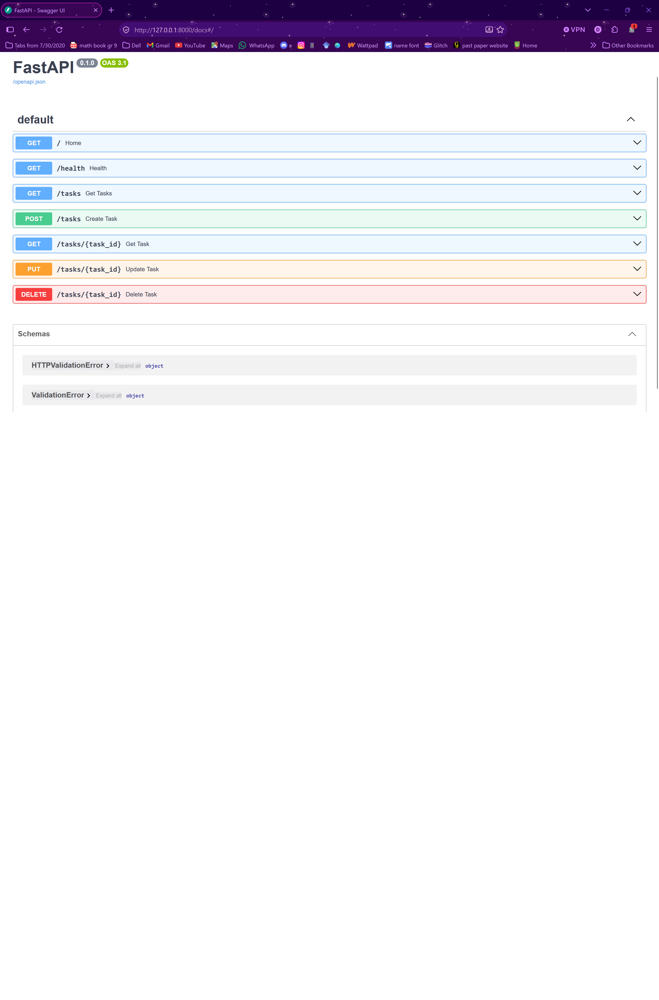
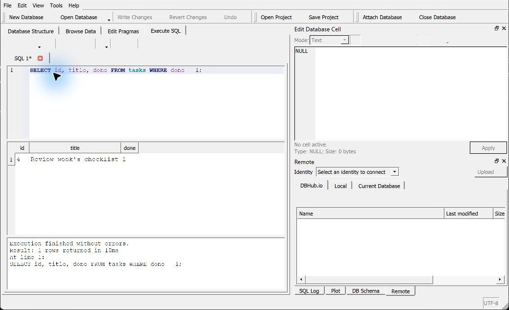

# Task API

A to-do REST API built with Python and FastAPI for the FlyRank Backend Track. Week 2 introduced the CRUD endpoints and Swagger UI. Week 3 moved task storage to SQLite so changes survive server restarts.

## Run locally

Use Python 3.10 or later. From a fresh clone, set up the dependencies in PowerShell.

```powershell
git clone https://github.com/dashdibyanshi2006/task-api.git
cd task-api
python -m venv venv
.\venv\Scripts\python.exe -m pip install -r requirements.txt
```

Start the server from the repository root.

```powershell
.\venv\Scripts\python.exe -m uvicorn main:app
```

Swagger UI is available at [http://127.0.0.1:8000/docs](http://127.0.0.1:8000/docs).

## API endpoints

| Method | Endpoint | Success | Behavior |
|---|---|---|---|
| GET | `/` | 200 | Get API information |
| GET | `/health` | 200 | Check server health |
| GET | `/tasks` | 200 | List tasks |
| GET | `/tasks/{task_id}` | 200 | Get one task |
| POST | `/tasks` | 201 | Create a task with a title and set `done` to `false` |
| PUT | `/tasks/{task_id}` | 200 | Update the title, completion status, or both |
| DELETE | `/tasks/{task_id}` | 204 | Delete a task and return an empty body |

POST requires a nonblank string title and trims surrounding whitespace. PUT requires at least one of `title` or `done` and validates supplied values before writing. Invalid request bodies return 400 with a JSON error. Unknown task IDs return 404 with a JSON error such as `{"error":"Task 999 not found"}`.

## Verify the API

The checked-in JSON files can be used to repeat the Week 2 curl requests against SQLite. Replace `4` with the ID returned by POST if it differs.

```powershell
curl.exe -i http://127.0.0.1:8000/tasks
curl.exe -i -H "Content-Type: application/json" --data-binary "@body.json" http://127.0.0.1:8000/tasks
curl.exe -i http://127.0.0.1:8000/tasks/4
curl.exe -i -X PUT -H "Content-Type: application/json" --data-binary "@update.json" http://127.0.0.1:8000/tasks/4
curl.exe -i -X DELETE http://127.0.0.1:8000/tasks/4
curl.exe -i http://127.0.0.1:8000/tasks/999
curl.exe -i -H "Content-Type: application/json" --data-binary "@blank.json" http://127.0.0.1:8000/tasks
```

The expected statuses are 200, 201, 200, 200, 204, 404, and 400. To check persistence, stop and restart the server after POST or PUT, then repeat the GET for the same ID. The same endpoints and task JSON work before and after the storage change, so clients can use the API without knowing how the data is stored.



## SQLite storage

SQLite keeps tasks in a single local file and needs no database server. Python includes the `sqlite3` library. On first start, the API creates `tasks.db` alongside `main.py`, creates the table, and seeds three example tasks. The seed is committed as one transaction so an interrupted write cannot leave a partial set of examples. Later startups preserve existing data, including a list you have emptied. The database file is Git-ignored so each clone starts fresh.

## SQLite walkthrough

The `tasks` table has an integer ID, a title, and a completion flag. SQLite stores the flag as `0` or `1`. The API returns it as `false` or `true`.

```sql
SELECT id, title, done FROM tasks WHERE done = 1;
```

On the walkthrough database this returned one row, task 4, after marking it complete with `PUT /tasks/4`. Running `UPDATE tasks SET done = 1` in DB Browser changed the live API response from one to five completed tasks without a restart. Running `DELETE FROM tasks WHERE done = 1` on a separate disposable database also changed the next `GET /tasks` response.

To repeat the read-only query, open `tasks.db` in DB Browser for SQLite and paste the query into **Execute SQL**. Use a disposable copy for the UPDATE and DELETE examples.


