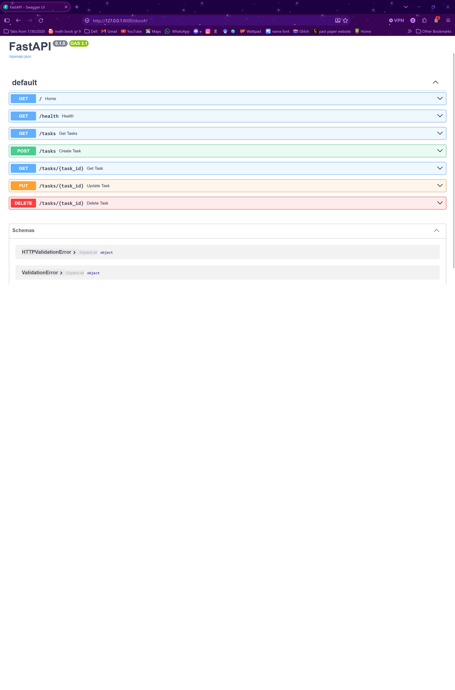

# Task API

A simple in-memory To-Do REST API built with Python and FastAPI as part of the **FlyRank AI Backend Track — Week 2, Assignment A1**.

This project helped me understand how backend APIs work by building and testing endpoints for creating, retrieving, updating, and deleting tasks.

## Features

- Retrieve API information and check server health.
- View all tasks or retrieve a specific task by ID.
- Create new tasks with a title.
- Update a task's title and completion status.
- Delete tasks by ID.
- Validate user input and return appropriate HTTP status codes.
- Test endpoints through FastAPI's interactive Swagger UI.

## Technologies Used

- **Python** — application logic.
- **FastAPI** — building the REST API.
- **Uvicorn** — running the development server.
- **Swagger UI** — testing API endpoints interactively.
- **Git and GitHub** — version control and project hosting.

## Getting Started

### Prerequisites

- Python installed.
- Git installed.
- A terminal and a code editor.

### Installation and Setup

**1. Clone the repository**

```bash
git clone https://github.com/dashdibyanshi2006/task-api.git
cd task-api
```

**2. Create and activate a virtual environment on Windows**

```powershell
python -m venv venv
venv\Scripts\activate
```

**3. Install the dependencies**

```bash
pip install fastapi uvicorn
```

**4. Start the development server**

```bash
uvicorn main:app --reload
```

**5. Open the API documentation**

Visit [http://127.0.0.1:8000/docs](http://127.0.0.1:8000/docs) in your browser to explore and test the endpoints.

The API stores tasks in memory. Task changes are not persistent and reset when the server restarts.

## API Endpoints

| Method | Endpoint | Description |
|---|---|---|
| GET | `/` | Retrieve API information |
| GET | `/health` | Check server health |
| GET | `/tasks` | Retrieve all tasks |
| GET | `/tasks/{task_id}` | Retrieve a task by ID |
| POST | `/tasks` | Create a task |
| PUT | `/tasks/{task_id}` | Update a task |
| DELETE | `/tasks/{task_id}` | Delete a task |

## Example Request

Create a task using `POST /tasks` with the following JSON body:

```json
{
  "title": "Finish FlyRank assignment"
}
```

A successful request returns `201 Created` and a task containing its ID, title, and completion status.

## Input Validation and Error Handling

- Task titles are required when creating a task.
- Titles must be strings and cannot be empty or contain only whitespace.
- Leading and trailing whitespace is removed from new task titles.
- Task updates must include at least one field: `title` and/or `done`.
- The `done` field must be a boolean (`true` or `false`).
- Requests for nonexistent task IDs return `404 Not Found`.

### HTTP Status Codes

| Status code | Meaning |
|---|---|
| `200 OK` | Request completed successfully |
| `201 Created` | A new task was created |
| `204 No Content` | A task was deleted successfully |
| `400 Bad Request` | The request contains invalid task data |
| `404 Not Found` | The requested task does not exist |

## Example curl Output

**Request:**

```bash
curl.exe -i http://127.0.0.1:8000/health
```

**Response:**

```http
HTTP/1.1 200 OK
date: Tue, 13 Oct 2026 17:09:52 GMT
server: uvicorn
content-length: 15
content-type: application/json

{"status":"ok"}
```

## Swagger UI

FastAPI automatically generates interactive API documentation, allowing endpoints to be tested without a separate API client.


## What I Learned

While building this project, I practised:

- Understanding REST APIs and CRUD operations.
- Creating endpoints using FastAPI decorators.
- Handling HTTP methods such as GET, POST, PUT, and DELETE.
- Reading JSON request bodies and returning JSON responses.
- Working with Python lists and dictionaries to store task data.
- Using path parameters to retrieve, update, and delete individual tasks.
- Using `if` conditions, `for` loops, and `return` statements to control program flow.
- Validating user input and returning appropriate error responses.
- Using f-strings to create dynamic error messages.
- Running a local development server and testing requests using `curl`.
- Understanding virtual environments and why in-memory data resets when the server restarts.
- Testing API behaviour to ensure changes do not break existing functionality.

## Future Improvements

- Store tasks in a database so they persist after restarting the server.
- Improve request validation using Pydantic models.
- Add automated tests for the API endpoints.
- Improve task ID generation to prevent duplicate IDs after deletion.

## Project Context

Built as a beginner backend project for the FlyRank AI Backend Track, Week 2, Assignment A1.
